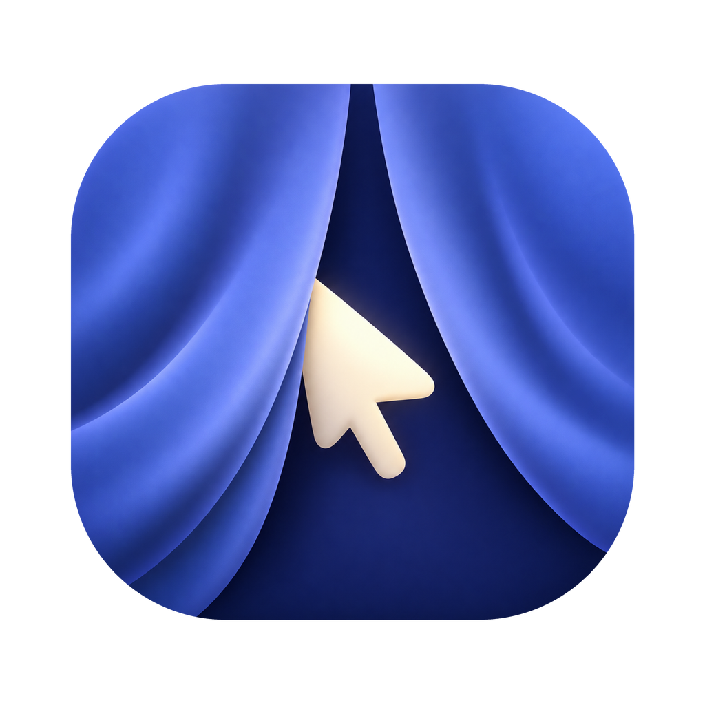
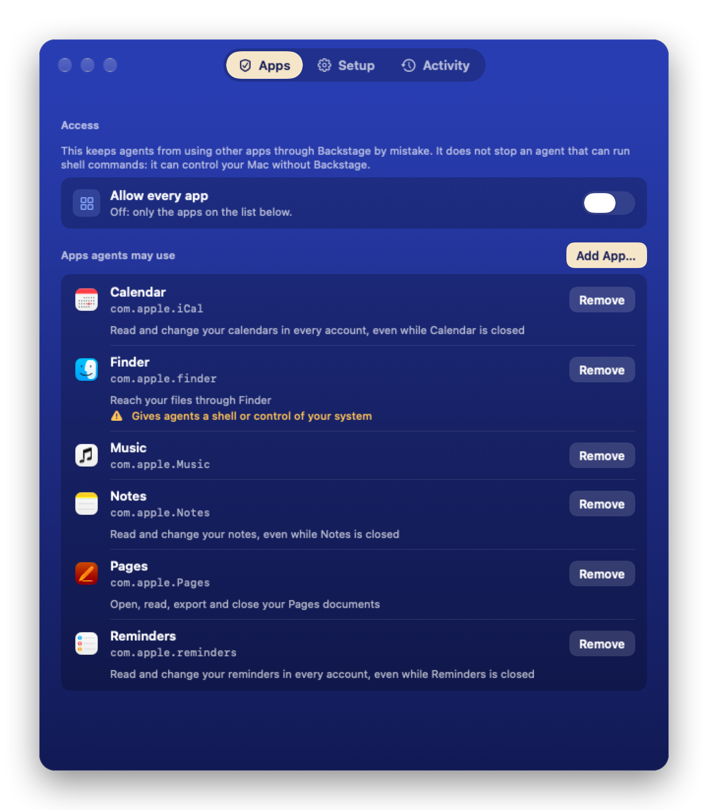

<p align="center">
  
</p>

<h1 align="center">Backstage</h1>

<p align="center">Let AI agents use your Mac's apps in the background, while you keep working.</p>

<p align="center">
  <a href="https://github.com/padmk/backstage/releases/latest"></a>
  
  
  
  <a href="LICENSE"></a>
  <a href="https://foreverbeta.app/backstage/"></a>
</p>

<p align="center">
  <a href="#install"><b>Install</b></a> ·
  <a href="#see-it-work"><b>See it work</b></a> ·
  <a href="#for-ai-agents"><b>For AI agents</b></a> ·
  <a href="#tools"><b>Tools</b></a> ·
  <a href="#which-apps-agents-may-use"><b>Access</b></a> ·
  <a href="#documentation"><b>Docs</b></a> ·
  <a href="CHANGELOG.md"><b>Changelog</b></a>
</p>

**Backstage is an MCP server that operates Mac apps for Claude Code, Codex or any other MCP client.** An agent reads a window as numbered elements, presses, types and drags by number, and is told exactly what changed, without bringing the app forward or moving your cursor. For well-known apps it skips the window and uses the app's own automation instead.

- **Works behind your back, not in your way.** Nothing activates an app, takes your focus or moves the pointer, except the few actions that say so and need `foreground: true`. Requests for one app run one at a time, and an agent backs off while you work in that app.
- **Says what happened, not what it hopes.** Every action reports how it was delivered and what changed once the app settled, or says plainly that it could not tell.
- **Ready operations for well-known apps.** Read WhatsApp chats and the Messages history, find and export photos, add reminders and events, search notes and mail, fill Numbers cells: typed operations that run while the app is hidden or closed, most of them also on a locked screen, and that read their result back.
- **Every app's menu commands, by name.** `list_menu_commands` shows what any app can do, with its shortcuts, and `run_menu_command` runs `File > Export…` without opening a menu, also in apps Backstage has never seen.
- **Hears what an app plays.** `record_audio` records an app's sound into a file, muted for you, such as a voice message that cannot be downloaded.
- **Reads views without elements.** `screenshot` with `text: true` recognizes the text of canvases, remote desktops and other custom views on this Mac, with each line's place for `click_at`.
- **Several steps, one call.** `run_actions` runs up to 20 actions in an app and reports their combined effect once.
- **You decide which apps.** Agents can use only the apps on your list, and nothing asks during a task. Password managers, authenticators, wallets and the system's login prompts are never available.
- **Local and independent.** No account, no telemetry, no dependency on any AI product. Everything is Swift: a small command speaks MCP, and a signed helper app does the work.

## See it work

An agent adds a reminder without opening Reminders: `run_operation` with `app: "Reminders"`, `operation: "add"` and `arguments: { "title": "Call the dentist", "due": "2026-11-14T09:00" }` replies

```json
{ "operation": "add", "id": "8C1F…", "title": "Call the dentist", "list": "Reminders", "completed": false,
  "priority": "none", "due": "2026-11-14T09:00:00+01:00", "verified": true }
```

For any other app it reads the window. `get_window_state` of the fixture app from the live test (shortened):

```text
app="Test Fixture" windows=[0*:"Fixture Main" 1:"Fixture Other"]
1 Window(StandardWindow) "Fixture Main"
  2 Button "Press Me" focused [Press]
  3 StaticText value="presses: 0"
  4 TextField placeholder="Plain" id="plain-field" editable [ShowMenu,Confirm]
  5 TextField secure placeholder="Secret" editable [ShowMenu,Confirm]
  6 Slider value="10" editable [Increment,Decrement]
```

`press` with `element: 2` presses the button in the background, while you work in another app, and replies with what changed:

```json
{ "delivery": "accessibility", "action": "AXPress",
  "state": { "changed": true, "removed": ["3 StaticText value=\"presses: 0\""], "added": ["3 StaticText value=\"presses: 1\""] } }
```

## Install

You need a Mac with Apple silicon and macOS 26 or newer, and the Xcode command line tools (`xcode-select --install`). With [Homebrew](https://brew.sh):

```sh
brew install padmk/tap/backstage
backstage setup
```

From a checkout: `git clone https://github.com/padmk/backstage`, then `make install` in it.

`setup` installs the app into `/Applications`, waits for you to enable it under **Accessibility**, the one permission it needs, registers the `backstage` MCP server with Claude Code and Codex, and opens the window where you choose the apps agents may use. For other MCP clients it prints the configuration to paste.

- Screen Recording and System Audio Recording are optional, for screenshots and `record_audio`; the window asks when an agent first needs one ([Optional permissions](docs/install.md#optional-permissions)).
- The app is signed with a certificate of this Mac, so permissions survive updates without a paid developer account; to update, run `brew upgrade backstage` and `backstage setup` ([Signing and updates](docs/install.md#signing-and-updates)).
- `backstage uninstall` removes the app and its registrations ([Uninstall](docs/install.md#uninstall)).

## For AI agents

If you are an agent asked to install Backstage: follow [Install](#install). It needs the user at the keyboard once, to enable Accessibility and to choose apps on the Apps tab; say so, and do not try to grant permissions or change the app list yourself.

If you are an agent using Backstage: check `list_apps` before using an app by any route, prefer `list_operations` and `run_operation`, then menu commands, then the window; act by element number and read `state` in each reply; never retry a change that returned `outcome_unknown` without reading first. [Using them well](docs/tools.md#using-them-well) has the full guidance, and the server repeats it in its MCP instructions.

## Tools

24 tools, with every argument, reply and error code in [docs/tools.md](docs/tools.md):

- **Apps and operations:** `list_apps`, `launch_app`, `list_operations`, `run_operation`
- **Reading:** `get_window_state`, `read_text`, `screenshot` (with the text recognized in it, on this Mac)
- **Acting:** `press`, `set_value`, `type_text`, `select_text`, `press_key`, `scroll`, `drag`, `click_at`, `run_actions`
- **Windows:** `list_windows`, `set_window`, `set_app_state`, `close`
- **Menus:** `list_menu_commands`, `run_menu_command`
- **Waiting and recording:** `wait_for`, `record_audio`

Apps with ready operations:

| App | Operations |
|---|---|
| Notes | `list_folders`, `search`, `read`, `create` |
| Reminders | `list_lists`, `list`, `read`, `add`, `update`, `complete` |
| Calendar | `list_calendars`, `list_events`, `get_event`, `create_event`, `update_event` |
| Contacts | `search`, `read`, `add` |
| Mail | `list_mailboxes`, `search`, `read`, `set_read`, `create_draft` (never sends) |
| Messages | `list_chats`, `read_chat`, `save_attachment`, `send` |
| WhatsApp | `list_chats`, `read_chat`, `save_media` |
| Photos | `list_albums`, `list_media`, `export` |
| Music | `now_playing`, `control`, `play`, `set_volume`, `list_playlists` |
| Finder | `selection`, `front_folder`, `reveal`, `get_tags`, `set_tags`, `trash` |
| Pages | `list_documents`, `open`, `read_text`, `export_pdf`, `close` |
| Numbers | `list_documents`, `open`, `read_table`, `set_cell`, `set_cells`, `export_pdf`, `close` |
| Shortcuts | `list`, `run` |
| System Settings | `list_panes`, `open_pane`, `get_appearance`, `set_appearance`, `get_volume`, `set_volume` |

Home, Bear, Telegram, Discord and Chromium browsers get hints for their windows. Reading WhatsApp and the Messages history needs Full Disk Access, which the Setup tab helps you grant. Routes, contracts and measurements are in [App knowledge](docs/app-knowledge.md).

## Which apps agents may use

Agents may use an app through Backstage only when it is on your list, on the Apps tab, or when Allow every app is on there. Nothing asks during a task: an app that is not allowed is refused at once with `not_approved`, and the agent can tell you to add it. That keeps unattended and remote sessions within the apps you chose.

This keeps agents from using other apps through Backstage by mistake. It does not stop an agent that can run shell commands: it can control your Mac without Backstage, or edit the list. Backstage asks connected agents to respect the list by every route (osascript, Shortcuts, computer use, an app's data in `~/Library`) and never to change it; a cooperative agent follows that, but nothing enforces it. For an MCP client without a shell it is a real limit.

- List entries name the app's bundle id and signer, so another app claiming the same bundle id is not covered.
- Apps that give agents a shell or control of the system (terminals, Shortcuts, Finder, System Settings, Xcode and similar) carry a warning.
- Passwords, Keychain Access, the system's login, authentication and permission prompts, Backstage itself, and password managers, authenticators and wallets from other makers (such as 1Password, Bitwarden, LastPass, KeePassXC, Proton Pass, Yubico Authenticator, Ledger Live and Trezor Suite; the full list is in `Sources/App/Approvals.swift`) are never available, whatever the settings. Neither are the Apple menu, the Services and Share menus and a toolbar's Share button in any app, with the few gaps [SECURITY.md](SECURITY.md#design) lists.

`backstage approvals add <app>` only asks; the app goes on the list when you click Add in the window. [SECURITY.md](SECURITY.md) has the full model and what it does not protect against.

## Locked screen

While the screen is locked, ready operations and the menu bar keep working, and window requests stop with `screen_locked`. Backstage never unlocks the Mac, never asks for the password and never wakes the displays. The optional **Windows while locked** mode adds screenshots and input by position, unverified; [docs/locked-screen.md](docs/locked-screen.md) explains what it costs.

## The Backstage window

Open **Backstage** from `/Applications` to choose apps, allow optional permissions and see which agent used which app. [docs/window.md](docs/window.md) describes each tab.

<p align="center">
  
</p>

## Troubleshooting

Run `backstage doctor`: it checks macOS, the installed app and its signature, Accessibility, the optional permissions, the grants of the listed apps and the private macOS calls background delivery uses. Common fixes are in [Troubleshooting](docs/install.md#troubleshooting).

## Documentation

- [Tools](docs/tools.md): every tool, its arguments and defaults, action replies and error codes
- [Install](docs/install.md): requirements, setup, the command line, signing and updates, uninstalling, files, troubleshooting
- [The Backstage window](docs/window.md): the Apps, Setup and Activity tabs
- [App knowledge](docs/app-knowledge.md): ready operations, their routes, contracts and measurements
- [Locked screen](docs/locked-screen.md): what changes when the screen locks, and Windows while locked
- [Architecture](docs/architecture.md): the parts, a request step by step, background input, updates, and why
- [Security](SECURITY.md) and [privacy](PRIVACY.md): the security model, signing, what leaves the Mac and what stays on disk
- [Development](docs/development.md): commands, tests, CI and the code map; [benchmark](bench/README.md); [changelog](CHANGELOG.md)

## License

[MIT](LICENSE). The app icon was made for Backstage and is covered by the same license. Report vulnerabilities as described in [SECURITY.md](SECURITY.md).

Apple, macOS and the names of Apple's apps are trademarks of Apple Inc.; Claude Code is a product of Anthropic and Codex of OpenAI. Backstage is an independent project, not affiliated with or endorsed by them.

<p align="center"><sub>Made by <a href="https://foreverbeta.app">foreverbeta</a></sub></p>
