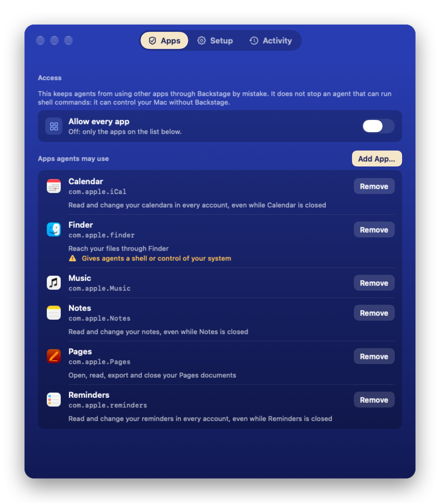
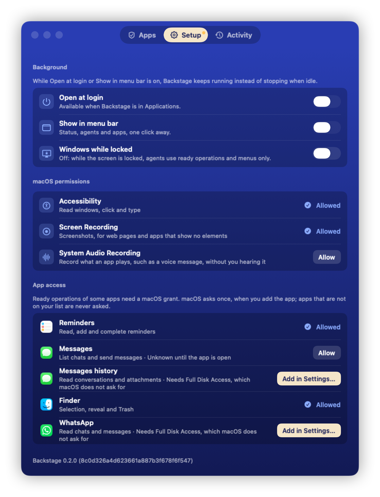
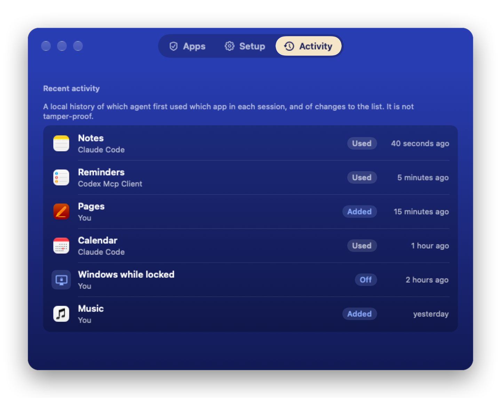

# The Backstage window

Open **Backstage** from `/Applications` to see and change everything in one window, with three tabs. It is the only place where apps go on the list.

  

  
  

- **Waiting for you**, above every tab while something waits: apps asked for from the command line or by an agent, with Add and Decline, and permissions an agent needed, with Allow and Not Now. Nothing changes until you choose. When a request arrives, the window comes forward once and takes the first click, so one click on Add or Allow acts.
- **Apps:** Allow every app (any app except password managers, authenticators, wallets, login and permission windows, and Backstage), and otherwise the list of apps agents may use, with Add App… and Remove. Far-reaching apps carry their warning. While Allow every app is on, the list folds away and is kept for when it goes off. While an app's ready operations wait for a macOS grant, a line here leads to Setup, and the Setup tab carries a dot.
- **Setup:**
  - Under Background: Open at login and Show in menu bar (off by default; its menu shows whether Backstage is ready, which agents are connected and the apps on the list), both available in the copy in `/Applications`; and Windows while locked (off by default, see [Working while the screen is locked](locked-screen.md#windows-while-locked)).
  - Under macOS permissions: Accessibility, which Backstage needs; Screen Recording, which is optional and used for screenshots, for web pages and apps that show no elements; and System Audio Recording, which is optional and used only by `record_audio`. Each has one Allow button: it shows macOS's prompt, or opens the right pane of System Settings and says what to turn on there. Backstage notices the change by itself; for a grant that macOS gives only to a new process, it turns new requests away with `restarting`, restarts itself once the running ones have finished and opens the window again.
  - Under App access: an Allow button for each macOS grant that the listed apps' ready operations use (Calendars, Reminders, Contacts, Photos, and Automation of Notes, Mail, Messages, Finder, Pages, Numbers, Music and System Events); all of them while Allow every app is on. Once macOS has answered, only System Settings can change the answer, so a declined grant offers Open Settings… instead. The WhatsApp and Messages history rows offer Add in Settings…, which opens Full Disk Access with a panel holding a large Backstage icon to drag into the list; the panel closes once the grant is on.
  - The window opens here while Accessibility is missing.
- **Activity:** which agent first used which app in each session, changes to the list, and changes to Allow every app and Windows while locked, from the log [SECURITY.md](../SECURITY.md#design) describes. The agent's name is the one its MCP client reports, kept to one line of at most 40 characters. Times are relative and advance while the tab is open.

The app has a Dock icon only while this window is open. Otherwise it runs unseen and stops 2 minutes after the last client disconnects, unless Open at login or the menu bar item is on. A launch at login stays unseen.
